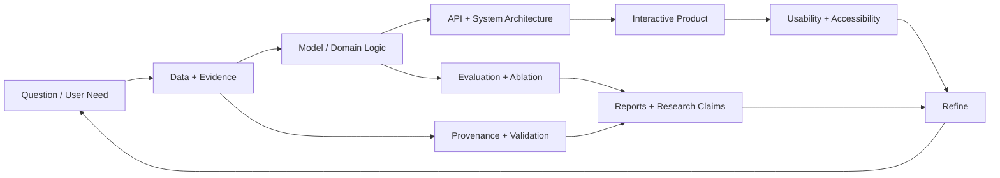
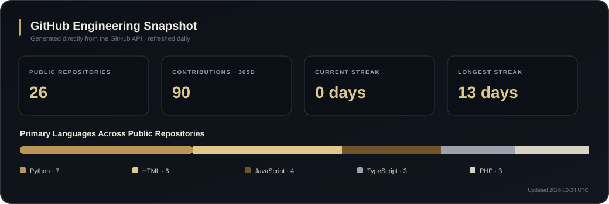

<!--
  GitHub Profile README — Tahmid Ahmed Talukder (@tahmidd01)
  Designed for GitHub's Markdown/HTML renderer: no JavaScript, iframe, or custom CSS required.
-->

<div align="center">
  

  <br />

  <h1>Tahmid Ahmed Talukder</h1>

  <p>
    <strong>CSE Graduate · AI/ML Engineer · Research-Driven Software Engineer</strong>
  </p>

  <p>
    Building explainable AI, reproducible research systems, full-stack products,<br />
    and local-first interactive software from Dhaka, Bangladesh.
  </p>

  <p>
    <a href="https://tahmidd01.github.io/tahmidd01/"></a>
    <a href="./documents/resume.pdf"></a>
    <a href="https://www.linkedin.com/in/tahmid-ahmed-talukder-417712285"></a>
    <a href="mailto:tahmidahmed789456@gmail.com"></a>
  </p>

  
</div>

---

## 01 // Profile

I am a **Computer Science and Engineering graduate from United International University (UIU), Bangladesh**, working at the intersection of **artificial intelligence, machine learning, software engineering, and applied research**.

I enjoy taking difficult ideas all the way from **research question → system architecture → implementation → evaluation → usable interface**. My work spans explainable and multimodal AI, NLP, local-first software, full-stack systems, data/research tooling, computational genomics, Green AI, interactive visualization, and human-centered design.

My strongest projects are deliberately built to be **inspectable**: I care about provenance, reproducibility, uncertainty, honest evaluation boundaries, privacy, accessibility, and polished product design—not just a model score or a working demo.

<table>
<tr>
<td width="25%"><strong>🎓 Education</strong></td>
<td>BSc in Computer Science &amp; Engineering · United International University · 2022–2026</td>
</tr>
<tr>
<td><strong>🧠 Core focus</strong></td>
<td>Explainable AI · Multimodal ML · NLP · Research Engineering · Intelligent Software</td>
</tr>
<tr>
<td><strong>🏆 Project-show signal</strong></td>
<td>4th Runner-Up · 1st Runner-Up · Top 10 across three UIU CSE Project Show projects</td>
</tr>
<tr>
<td><strong>📄 Research</strong></td>
<td>Published co-author · FYDP research manuscript prepared for publication · reproducible experimental systems</td>
</tr>
<tr>
<td><strong>🌍 Open to</strong></td>
<td>AI/ML Engineering · Software Engineering · Research Engineering · International collaborations</td>
</tr>
</table>

> **Engineering principle:** a strong intelligent system should not only produce an answer—it should make its data flow, evidence, uncertainty, assumptions, and user impact understandable.

---

## 02 // Recognition Console

<div align="center">


</div>

| Recognition | Project / context |
|---|---|
| 🏅 **4th Runner-Up — UIU CSE Project Show** | **Synapse Atlas**, Final Year Design Project |
| 🥈 **1st Runner-Up — Advanced OOP, UIU CSE Project Show** | **ArcadiaFX**, JavaFX gaming platform |
| 🔟 **Top 10 — Software Engineering Lab, UIU CSE Project Show** | **Cognisense**, AI skill-assessment platform |
| 📄 **Published co-author** | *Quantum Computing Applications in High-Speed Signal Processing for EEE Systems*, IJEBM (2024) |
| 🤝 **Four international education roadshows** | IDP Education volunteer · Dhaka · 2024–2025 |

---

## 03 // Flagship System — Synapse Atlas

### 🧠 [Synapse Atlas](https://github.com/tahmidd01/Synapse-Atlas)

**Neuro-Symbolic Multimodal AI for Interpretable Depression Screening with Proxy Anxiety and Psychological Distress Indicators**

My five-member FYDP team built a **local-first research platform** designed to make model reasoning inspectable rather than hiding it behind a single opaque mental-health score.

- Eight supervised **ordinal PHQ-8 symptom concepts** form the primary path to the total score.
- **MentalRoBERTa** provides the retained text representation; symbolic rules compute the total, severity band, and research screening flag.
- **Whisper / WavLM** support audio and video workflows without silently overriding the text-primary PHQ path.
- Separate proxy-anxiety and trauma-related distress pathways remain explicitly bounded.
- **Synapse Guide** uses a local **Qwen3 4B + llama.cpp** assistant with curated retrieval and structured result context.
- Includes concept intervention, provenance-aware evidence exploration, uncertainty display, local operation, and post-evaluation QA.

| Frozen evaluation / QA | Result |
|---|---:|
| Official frozen TEST sessions | **56** |
| RMSE | **4.8885** |
| MAE | **3.9894** |
| Positive F1 | **0.6500** |
| PR-AUC | **0.7215** |
| Guarded software tests | **148** |
| Responsive size/theme QA combinations | **24** |

🏅 **4th Runner-Up — UIU CSE Project Show**  
[**Repository ↗**](https://github.com/tahmidd01/Synapse-Atlas) · [**Video Demo ↗**](https://drive.google.com/file/d/1bWOSirrL4UQg5F0kgw9MDODfrcvsxUwG/view?usp=drive_link)

> Synapse Atlas is a research prototype, not a clinical diagnosis or treatment service. I value keeping that boundary explicit.

---

## 04 // Selected Engineering Systems

| | |
|---|---|
| 🛡️ **[Friction by Design](https://github.com/tahmidd01/Friction-by-Design-A-Systematic-Audit-of-Dark-Patterns-in-Account-Security-Hardening-Flows)**<br><br>Privacy-aware research platform for measuring friction in account-security interfaces while separating objective observations from interpretive dark-pattern coding.<br><br>`Python` `SQLite` `research tooling` `browser evidence` `reproducibility`<br><br>**Signal:** 10-service frozen pilot · 7 security journeys · 70 genuine human observations · 30 automated pre-auth stages · **163/163 tests passing** · release-check + reproduction passing. | 🚘 **[Motor Atlas](https://github.com/tahmidd01/Motor-Atlas)**<br><br>Local automotive museum and discovery platform with deep filtering, comparison, command search, curated historical/engineering context, responsive galleries, and an optional Three.js workshop.<br><br>`React 19` `TypeScript` `Vite` `React Router` `Three.js` `Zod` `Playwright`<br><br>**Signal:** 34 variants · 26 manufacturers · typed data model · data validation · browser E2E testing · accessibility and reduced-motion support. |
| 🌱 **[Green AI Benchmark](https://github.com/tahmidd01/Updated-GreenAI-Benchmark)**<br><br>Controlled **PyTorch vs TensorFlow** CPU benchmark using matched CIFAR-10 data, starting weights, architecture, optimizer settings, and execution controls.<br><br>`Python` `PyTorch` `TensorFlow` `CIFAR-10` `energy / CO₂ evaluation`<br><br>**Measured:** PyTorch was **59.6% faster on Intel** and **74.2% faster on AMD**, with **57.9%** and **67.8%** lower measured energy/CO₂ respectively in the recorded environments. | ✿ **[Iris Intelligence](https://github.com/tahmidd01/Iris-Intelligence)**<br><br>Reproducible local ML platform combining dataset provenance, model selection, interactive analytics, persisted inference, model-performance diagnostics, educational explanations, testing, and a generated research report.<br><br>`Python` `scikit-learn` `Streamlit` `Plotly` `pytest`<br><br>**Verified:** Decision Tree selected · **96.67% held-out accuracy** · **0.9666 macro-F1** · 7 application workspaces. |
| 🧩 **Cognisense**<br><br>Full-stack AI skill-assessment platform supporting **voice, video, and text**, transcription, semantic/NLI scoring, topic validation, RAG assistance, real-time collaboration, RBAC, notifications, and generated PDF CV/certificates.<br><br>`Laravel 11` `FastAPI` `MySQL` `ChromaDB` `SBERT` `faster-whisper` `WebSockets`<br><br>**Recognition:** Top 10 · UIU CSE Project Show · [**Video Demo ↗**](https://drive.google.com/file/d/1JPxF7CH7CPxsjtukzjeVjFtNK-J3tOQJ/view?usp=sharing) | 🎮 **[ArcadiaFX](https://github.com/tahmidd01/ArcadiaFX)**<br><br>Modular Java desktop gaming hub containing **20 functional games**, unified launching, persistent player data, authentication, real-time chat, AI-assisted discovery, reporting, caching, and background processing.<br><br>`Java 17` `JavaFX 17` `FXGL` `Maven` `MySQL` `WebSockets`<br><br>**Recognition:** 1st Runner-Up · Advanced OOP · [**Video Demo ↗**](https://drive.google.com/file/d/1TWQFiBEQizk36RfYkg7yuVR3XBBRF-SR/view?usp=sharing) |
| 🎓 **[AspireIELTS](https://github.com/tahmidd01/AspireIELTS)**<br><br>Full IELTS learning and assessment environment across Listening, Reading, Writing, and Speaking with timed workflows, persistence, AI-assisted writing feedback, live Jitsi speaking assessment, analytics, certificates, and admin tools.<br><br>`PHP` `MySQL` `JavaScript` `OpenAI API` `Jitsi Meet`<br><br>[**Video Demo ↗**](https://drive.google.com/file/d/1Tae5e4V5i2lmc6lWAb_rAGqDIjaWSz_c/view?usp=sharing) | 🌐 **[EdAcademix](https://github.com/tahmidd01/EdAcademix)**<br><br>Database-backed education-guidance platform for country/university exploration, admissions requirements, eligibility information, AI-assisted guidance, application workflows, and offer-letter requests.<br><br>`PHP` `MySQL` `JavaScript` `AI assistant` `relational data modeling` |

<details>
<summary><strong>Open the experimental systems shelf</strong></summary>
<br />

- **[Inkwell](https://github.com/tahmidd01/inkwell)** — interactive 3D notebook built with React, Vite, React Three Fiber/Drei, Framer Motion, Tailwind, and Zustand.
- **[Universee](https://github.com/tahmidd01/Universee)** — nine-chapter local interactive experience built with React, TypeScript, Vite, and Three.js, including accessible modal interactions and browser testing.
- **[TrustMesh](https://github.com/tahmidd01/TrustMesh)** — explainable local scam/social-engineering risk analysis with Flask, SQLite, interactive visualization, case storage, exports, analytics, and REST endpoints.
- **[MeshPulse 3D](https://github.com/tahmidd01/MeshPulse_3D)** — observability/chaos-engineering concept for visualizing service/agent topology and failure signals.
- **[Continuum OS](https://github.com/tahmidd01/continuum_os)** — local-first work-reentry system centered on context recovery and visual task continuity.
- **[DormPilot](https://github.com/tahmidd01/DormPilot)** — role-based hostel operations platform covering admissions, rooms, complaints, tasks, messaging, analytics, and PDF reporting.

</details>

---

## 05 // Research Portfolio

| Research | What I worked on | Core methods |
|---|---|---|
| **Synapse Atlas** | Interpretable mental-health screening research and productization | MentalRoBERTa, ordinal concepts, neuro-symbolic rules, uncertainty, Whisper, WavLM, local LLMs |
| **Friction by Design** | Systematic measurement of account-security interface friction | empirical study design, quality tiers, reproducibility, reliability, browser evidence |
| **CASH-HyperLBS** | Higher-order adverse drug-event modeling | PyTorch Geometric, signed/ambiguous hypergraphs, SapBERT, structural frustration, contrastive learning, LLM distillation |
| **PScnv-PoNMatch** | Confidence-aware CNV detection for unmatched targeted sequencing | Panel of Normals, Ridge regression, purity-aware calling, simulated multi-cancer evaluation |
| **Green AI Benchmark** | Framework-level efficiency under controlled parity | paired experiments, runtime, energy, CO₂, model-quality parity |
| **Shathi** | Bangla-first caregiving companion designed through user research | interviews, Figma, think-aloud testing, privacy/trust/accessibility design |

### Publication

**Co-author** — *Quantum Computing Applications in High-Speed Signal Processing for EEE Systems*  
*International Journal of Engineering, Business and Management*, Vol. 8, No. 4, 2024 · [**DOI 10.22161/ijebm.8.4.7 ↗**](https://doi.org/10.22161/ijebm.8.4.7)

---

## 06 // Technology Constellation

<div align="center">
  
</div>

<br />

| Layer | Technologies / methods |
|---|---|
| **Languages** | Python · Java · C · C++ · PHP · JavaScript · TypeScript · SQL · HTML · CSS |
| **AI / ML** | PyTorch · TensorFlow · PyTorch Geometric · Hugging Face Transformers · MentalRoBERTa · Wav2Vec2/WavLM · Whisper · SBERT · scikit-learn |
| **Web / APIs** | Laravel · FastAPI · Flask · React · Vite · REST APIs · WebSockets · Laravel Reverb · Jitsi Meet |
| **Data** | MySQL · MariaDB · SQLite · ChromaDB · relational modeling · vector retrieval · JSON/CSV pipelines |
| **Interactive systems** | JavaFX · FXGL · Three.js · React Three Fiber · Streamlit · Plotly · responsive/accessibility-minded UI |
| **Research practice** | experiment design · ablation · calibration · model evaluation · reproducibility · provenance · usability testing · technical writing |



---

## 07 // How I Build

```text
01  Frame the real problem before choosing the technology.
02  Make data lineage, assumptions, and evaluation boundaries explicit.
03  Separate research evidence from demo behavior and product polish.
04  Build end-to-end: UI → API → persistence → intelligence → evaluation.
05  Prefer inspectable logic when black-box complexity is not justified.
06  Test failure paths, not only the happy path.
07  Treat accessibility, privacy, and documentation as engineering work.
08  Ship something a human can understand, operate, and critique.
```

---

## 08 // GitHub Engineering Snapshot

<div align="center">
  
</div>

<p align="center">
  <sub>The local analytics card is generated from the profile repository workflow when the workflow is enabled.</sub>
</p>

---

## 09 // Beyond the Code

- 🤝 Volunteered across **four IDP Education international education roadshows** in Dhaka, supporting prospective students, parents, and university representatives.
- 🎤 Completed Grameenphone Academy professional-development modules in communication, presentation, CV development, LinkedIn, and interview skills.
- 🌐 Languages: **English (C1)** · **Bengali (C1)** · **Arabic (A2)**.
- 🔍 I am especially interested in work where **research discipline and product engineering meet**.

---

<div align="center">

## Let’s build something meaningful.

I am open to **AI/ML Engineering, Software Development, Research Engineering, and international collaboration**.

<a href="mailto:tahmidahmed789456@gmail.com"></a>
<a href="https://www.linkedin.com/in/tahmid-ahmed-talukder-417712285"></a>
<a href="https://tahmidd01.github.io/tahmidd01/"></a>

<br /><br />

<code>build → measure → explain → refine</code>

</div>
